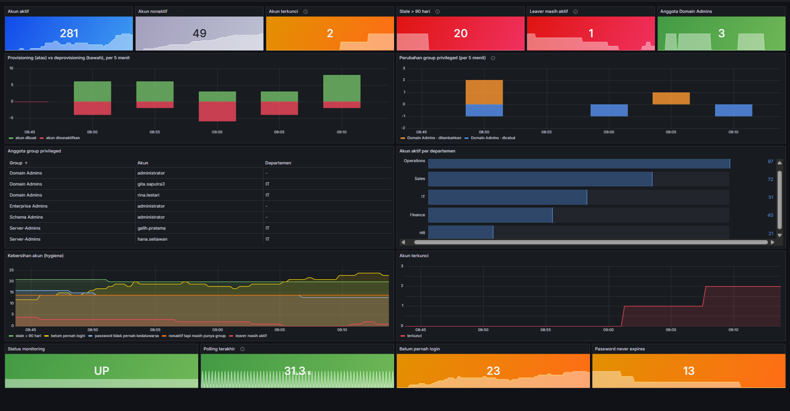
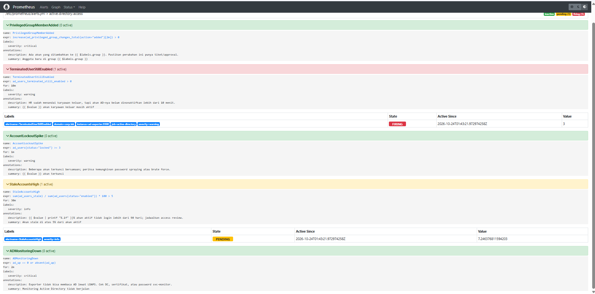
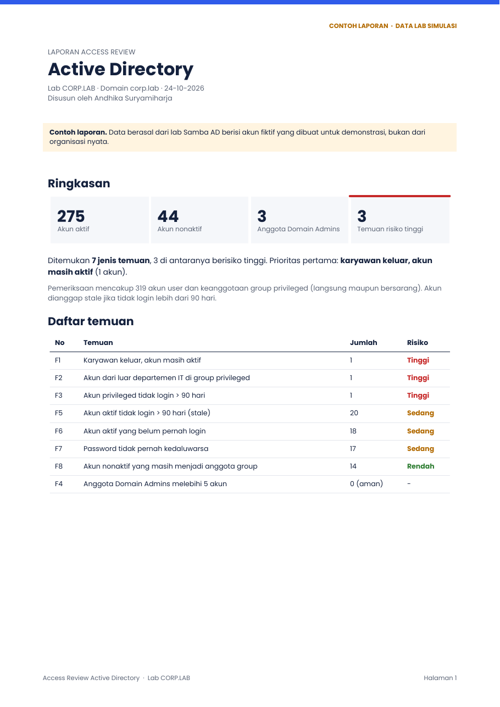

# Active Directory Access Monitoring

Dashboard dan alerting untuk **kebersihan akses Active Directory**: siapa yang punya akses, siapa yang seharusnya sudah tidak punya, dan kapan akses privileged berubah. Dibangun dengan **Prometheus + Grafana + Alertmanager → Telegram**, membaca AD lewat **LDAPS dengan akun read-only**.

Repo ini menyertakan lab lengkap: **domain controller Samba AD sungguhan** berisi ±300 akun dalam 5 departemen, plus simulator yang menjalankan aktivitas identitas sehari-hari (karyawan baru, karyawan keluar, login, brute force, perubahan group admin) supaya dashboard dan alert bisa diuji end-to-end.



---

## Hasil 30 menit pertama di lab

Lab dijalankan dengan 300 akun awal dan simulator aktif selama ±30 menit. Yang ditemukan dashboard dan alert:

| Temuan | Nilai | Kenapa penting |
|---|---|---|
| Karyawan keluar, akun masih aktif | 3 akun saat awal, alert **TerminatedUserStillEnabled** menyala | Mantan karyawan masih bisa login; risiko akses tidak sah |
| Akun stale (> 90 hari tidak login) | 20 akun = **7,2%** dari akun aktif | Melewati batas 5%: kandidat access review |
| Belum pernah login | 23 akun | Akun dibuat tapi tidak dipakai; sering terlupa saat provisioning |
| Password tidak pernah kedaluwarsa | 13 akun | Melanggar kebijakan password standar |
| Perubahan Domain Admins | 2 penambahan, 3 pencabutan | Setiap penambahan memicu alert critical ke Telegram |
| Akun terkunci | naik ke 2 | Indikasi awal brute force |

### Satu kejadian yang tertangkap

Simulator menambahkan **gita.saputra dari departemen Operations** ke **Domain Admins**. Tiga menit kemudian, akun yang sama keluar dari perusahaan dan di-deprovision.

Akun non-IT yang tiba-tiba mendapat hak admin domain, lalu resign tidak lama kemudian, adalah pola yang dicari tim security dalam investigasi insider threat. Di stack ini:
1. alert **PrivilegedGroupMemberAdded** menyala begitu penambahan terdeteksi (polling 30 detik),
2. tabel *Anggota group privileged* memperlihatkan akun Operations di antara akun IT,
3. grafik *Perubahan group privileged* mencatat penambahan dan pencabutannya, sehingga ada jejak waktu untuk investigasi.



---

## Pertanyaan yang dijawab dashboard ini

Pertanyaan yang biasa diajukan auditor, tim security, dan manajemen IT:

| Pertanyaan | Metrik |
|---|---|
| Berapa akun aktif, nonaktif, dan terkunci saat ini? | `ad_users{status}` |
| Siapa saja anggota Domain Admins dan group privileged lain? | `ad_privileged_group_member_info` |
| Kapan ada akun yang **ditambahkan ke group admin**? | `ad_privileged_group_changes_total` |
| Ada karyawan yang **sudah keluar tapi akunnya masih aktif**? | `ad_users_terminated_still_enabled` |
| Berapa akun yang **tidak login lebih dari 90 hari**? | `ad_users_stale` |
| Akun mana yang belum pernah login, atau password-nya tidak pernah kedaluwarsa? | `ad_users_never_logged_on`, `ad_users_password_never_expires` |
| Akun nonaktif yang masih menempel di group? | `ad_users_disabled_with_group_membership` |
| Bagaimana tren provisioning vs deprovisioning? | `ad_account_lifecycle_events_total{event}` |
| Ada indikasi brute force atau password spraying? | `ad_users{status="locked"}` |

## Alert ke Telegram

| Alert | Kapan berbunyi | Severity |
|---|---|---|
| PrivilegedGroupMemberAdded | Ada anggota baru di Domain Admins, Enterprise Admins, Schema Admins, atau Server-Admins | critical |
| TerminatedUserStillEnabled | Karyawan berstatus keluar, akun masih aktif > 10 menit | warning |
| AccountLockoutSpike | ≥ 3 akun terkunci bersamaan | warning |
| StaleAccountsHigh | Akun stale > 5% dari akun aktif selama 30 menit | info |
| ADMonitoringDown | Exporter gagal membaca AD > 2 menit | critical |

Semua aturan alert punya unit test (`prometheus/alerts_test.yml`), dijalankan dengan `promtool test rules`.

## Access review satu kali (tanpa memasang monitoring)

Folder [`access-review/`](access-review/) berisi skrip PowerShell **read-only** yang dijalankan tim IT klien dengan akun domain biasa, dan generator laporan PDF berisi temuan, tingkat risiko, dan rekomendasi. Lihat [contoh laporannya](access-review/contoh-laporan-access-review.pdf).



## Arsitektur

```
                    LDAPS (636, sertifikat diverifikasi)
Samba AD DC  ◄──────────────────────────────  ad-exporter ──► Prometheus ──► Grafana
(corp.lab)          akun svc-monitor (read-only)                   │
    ▲                                                              └──► Alertmanager ──► Telegram
    │ LDAPS (akun admin lab)
ad-simulator: karyawan baru/keluar, login, brute force, perubahan Domain Admins
```

## Keputusan desain dari sisi security

- **LDAPS dengan verifikasi sertifikat penuh.** Lab membuat CA sendiri dan menerbitkan sertifikat DC dengan SAN yang benar. Exporter memvalidasi sertifikat terhadap CA tersebut; tidak ada `CERT_NONE` atau simple bind lewat LDAP polos.
- **Least privilege.** Exporter memakai akun layanan `svc-monitor` yang hanya user domain biasa, tanpa hak admin, dan hanya membaca.
- **Tanpa container privileged.** Samba memakai modul `xattr_tdb` sehingga DC berjalan tanpa `privileged: true` atau `CAP_SYS_ADMIN`.
- **Container tools berjalan sebagai user non-root.**
- **Semua port hanya terbuka ke `127.0.0.1`**, tidak ke jaringan.
- **Kredensial hanya di `.env`**, yang tidak ikut ter-commit.

## Menjalankan

Kebutuhan: Docker dan Docker Compose. Di Windows, jalankan perintah dari Git Bash atau terminal lain.

```bash
cp .env.example .env      # ganti semua password (wajib kompleks)
docker compose up -d --build
docker compose logs -f ad-simulator   # lihat seeding 300 user lalu aktivitas simulasi
```

Inisialisasi pertama butuh ±1–2 menit (build image, provisioning domain, seeding user). Event provisioning dan perubahan group mulai terlihat beberapa menit setelahnya.

| Layanan | Alamat |
|---|---|
| Grafana | http://localhost:3001 (dashboard langsung menjadi beranda) |
| Prometheus | http://localhost:9091 |
| Alertmanager | http://localhost:9094 |
| LDAPS (untuk LDAP browser) | `localhost:636` |

Port dibuat berbeda dari stack monitoring MySQL di repo saya yang lain, sehingga keduanya bisa berjalan bersamaan.

Mengulang dari nol: `docker compose down -v && docker compose up -d --build`.

### Notifikasi Telegram
1. Buat bot lewat **@BotFather** dan salin token-nya.
2. Kirim pesan ke bot, lalu ambil `chat.id` dari `https://api.telegram.org/bot<TOKEN>/getUpdates`.
3. Isi keduanya di `alertmanager/alertmanager.yml`, lalu `docker compose restart alertmanager`.

## Menerapkan ke Active Directory sungguhan

Exporter tidak bergantung pada lab. Untuk domain produksi, cukup jalankan `ad-exporter` dengan:
- `AD_HOST` dan `AD_REALM` mengarah ke domain controller Anda,
- sertifikat CA perusahaan di `/tls/ca.crt`,
- akun layanan khusus yang hanya punya hak baca (pertimbangkan gMSA, dan batasi ke OU yang relevan),
- daftar group sensitif di `PRIVILEGED_GROUPS`.

Hal yang perlu disesuaikan untuk produksi:
- **Status karyawan keluar.** Lab memakai atribut `employeeType=Terminated`; di perusahaan, sumbernya biasanya sistem HR atau atribut lain, jadi sesuaikan logikanya.
- **Membership bersarang.** Exporter menghitung anggota langsung. Untuk nested group, gunakan filter `LDAP_MATCHING_RULE_IN_CHAIN` (`1.2.840.113556.1.4.1941`).
- **`lastLogonTimestamp`** hanya direplikasi setiap ±9–14 hari, sehingga cocok untuk deteksi akun stale, bukan untuk melacak login real-time.
- **Domain besar.** Pencarian sudah memakai paging; untuk puluhan ribu akun, naikkan interval polling.

## Struktur repo

```
samba/        Dockerfile + entrypoint domain controller (CA, sertifikat, provisioning, kebijakan lockout)
access-review/ skrip ekspor PowerShell read-only + generator laporan PDF
tools/        exporter.py (metrik Prometheus), simulate.py (data & aktivitas lab), adlib.py (koneksi LDAPS)
prometheus/   konfigurasi scrape, aturan alert, unit test alert
alertmanager/ routing ke Telegram
grafana/      datasource + dashboard yang ter-provision otomatis
```

---

## Jasa

Saya membantu tim memantau dan merapikan akses Active Directory: dashboard access review, alert perubahan group privileged, deteksi akun stale dan leaver, serta monitoring Grafana untuk sistem lain. Hubungi saya lewat [LinkedIn](#) atau [email](#).
